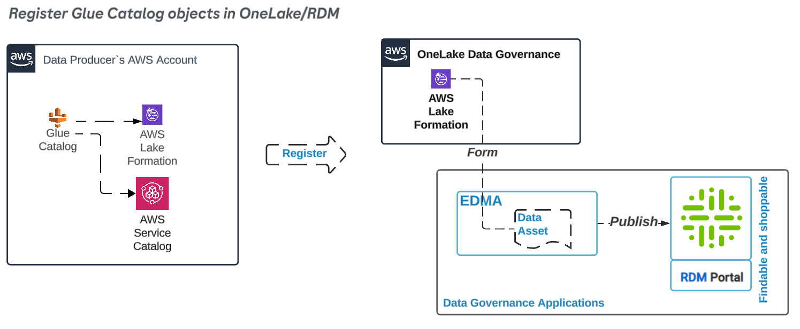
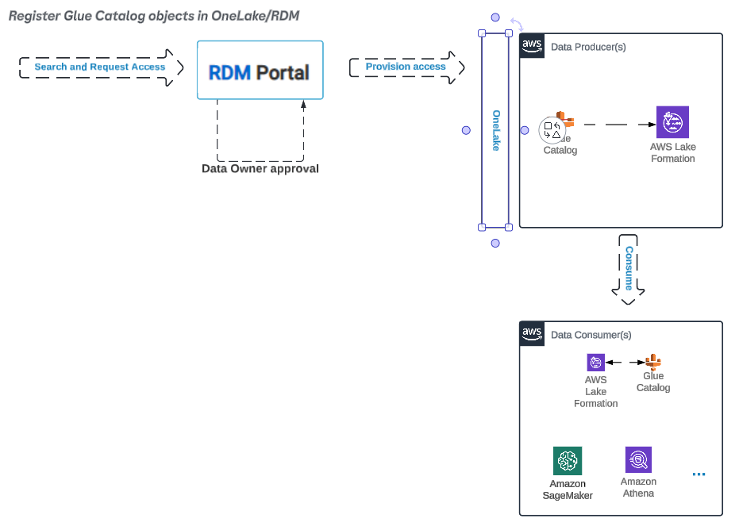

This text defines the **Glue Catalog** version of OneLake, which is the architectural evolution toward a **Data Mesh** model. Unlike the S3-based version, this model focuses on **Table-level** governance and interoperability.

Key points:

* * * * *

### 1\. Core Mission: Data Mesh & F.A.I.R.

OneLake for AWS Glue Catalog acts as a **self-service infrastructure** that decentralizes data ownership. Its goal is to make data:

-   **F**indable, **A**ccessible, **I**nteroperable, and **R**eusable (**F.A.I.R.**).

-   It achieves this by linking producers and consumers through **RDM** (Roche Data Marketplace) and **EDMA**.

### 2\. The Two Key Personas

The workflow is divided into two clear responsibilities:

-   **Data Producer:**

    -   **Action:** Creates Glue Data Assets and registers them in OneLake.

    -   **Goal:** Uses **EDMA** to assemble these assets into **Datasets** and **Data Products**.

-   **Data Consumer:**

    -   **Action:** Searches for a **Data Product** (not just a file) in the **RDM Portal**.

    -   **Goal:** Requests access and consumes the data directly within their own AWS Account.

### 3\. Structural Hierarchy (Nomenclature)

The text implies a "matryoshka" style organization of data:

1.  **Data Asset:** The technical Glue table.

2.  **Dataset:** A logical grouping of assets.

3.  **Data Product:** The final, governed package available for the business.

* * * * *

### Summary:

> "OneLake for Glue Catalog is our **Data Mesh** enabler. It moves us away from simply sharing 'folders' to sharing **Data Products**. It requires producers to register technical assets in **EDMA** so consumers can discover and use them as managed tables in their own AWS environments."