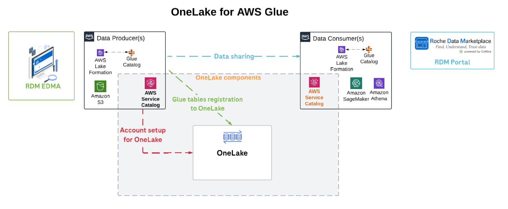

OneLake for AWS Glue Catalog uses few AWS Services to operate:

-   AWS Service Catalog for Data Producers to interact with OneLake - available after registering AWS Account in OneLake

-   AWS Glue Catalog as a Glue objects metadata store

-   AWS Lake Formation as a main service for access management of Glue objects

-   AWS AppSync as a backend service providing GraphQL endpoint available for Data Governance applications

The main goal is to support registration of AWS Glue tables (currently based on AWS S3) metadata in OneLake and at the end in RDM (EDMA, Collibra) and support shopping of Glue related Datasets between Data Producers and Data Consumers.