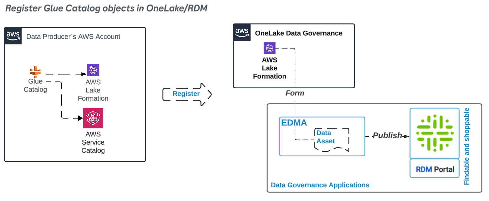
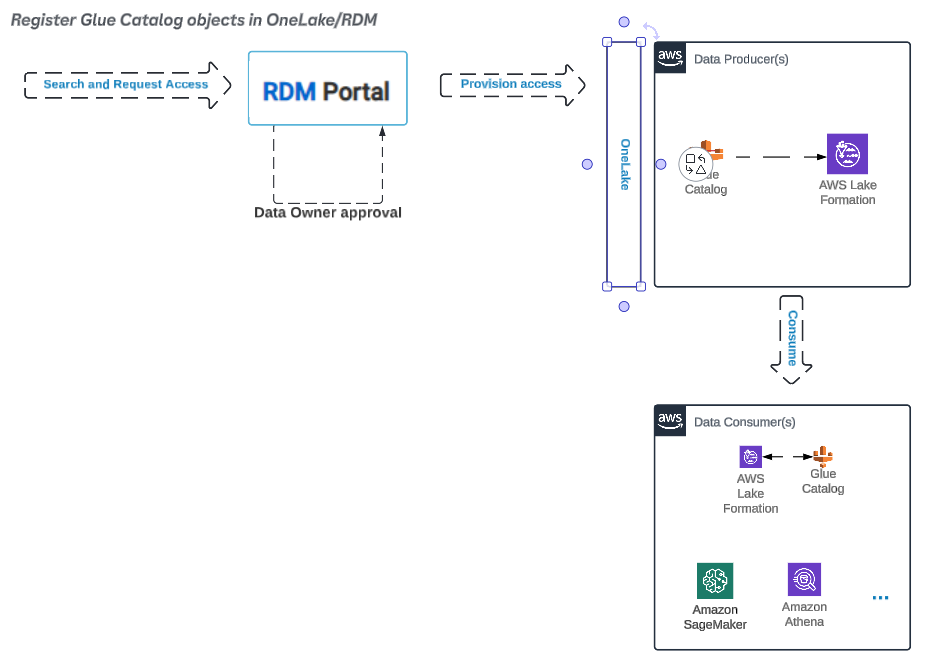

# OneLake for AWS Glue Catalog: Technical Architecture

> **Audience:** Data Engineers, Data Producers & Consumers evaluating OneLake models.
> **Prerequisites:** Familiarity with AWS S3 and AWS Glue. See [Glossary](../../../GLOSSARY.md) for key terms.

[OneLake](../../../GLOSSARY.md) for **AWS Glue** (formerly **ECAS DataHub**) is the [Data Mesh](../../../GLOSSARY.md) enabler. While the S3 model is about *storage*, the Glue model is about *metadata and sharing* at the table level.

Its goal is to make data [**F.A.I.R.**](../../../GLOSSARY.md) (Findable, Accessible, Interoperable, Reusable) by linking producers and consumers through [**RDM**](rdm-nomenclature.md) and [**EDMA**](../../../GLOSSARY.md).

---

## 1. The Architectural Shift

The fundamental difference between the two models lies in **Data Ownership & Storage**:

| Feature | OneLake for S3 | OneLake for AWS Glue |
|---------|---------------|---------------------|
| Storage Location | Centrally stored in OneLake AWS Accounts | Decentralized: Owned, stored, and managed by the Project's AWS Account |
| Asset Type | Files and Prefixes (Folders) | Glue Data Assets (Databases and Tables) |
| Management | Managed by OneLake storage policies | Managed by the Project Team (Data Mesh style) |
| Sharing Model | Sharing *folders* | Sharing **Data Products** |

---

## 2. Key Personas

The workflow is divided into two clear responsibilities:

### Data Producer

- **Action:** Creates Glue Data Assets and registers them in OneLake.
- **Goal:** Uses [**EDMA**](../../../GLOSSARY.md) to assemble these assets into [**Datasets** and **Data Products**](rdm-nomenclature.md).
- **Tool:** AWS Service Catalog Products for standardized, *push-button* registration.

### Data Consumer

- **Action:** Searches for a **Data Product** (not just a file) in the [**RDM Portal**](rdm-nomenclature.md).
- **Goal:** Requests access and consumes the data directly within their own AWS Account.
- **Experience:** Once approved, technical provisioning happens automatically.

---

## 3. Integrated Governance Tools

The Glue Catalog flavor follows the same governance backbone but with a different focus:

- **[EDMA](../../../GLOSSARY.md)** — Used by Producers to register and assemble Data Assets into Datasets and Data Products.
- **[RDM](rdm-nomenclature.md) Portal** — The central hub where Consumers search and *shop* for these Data Products.
- **OneLake for Glue** — Handles the technical *registration, searching, and sharing* of the Glue-specific assets.

---

> 💡 **Key Takeaway:**
>
> *"OneLake for Glue Catalog is our Data Mesh enabler. It moves us away from simply sharing 'folders' to sharing **Data Products**. Producers register technical assets in EDMA so consumers can discover and use them as managed tables in their own AWS environments — making data [F.A.I.R.](../../../GLOSSARY.md) without losing control over the physical storage."*

---

## 4. Which Model Should I Choose?

Use the following decision tree to determine the right approach for your project:

| Question | If Yes → | If No → |
|----------|----------|---------|
| Do you need to retain full control of data storage in your own AWS account? | **Glue Model** | Consider S3 Model |
| Are you sharing data at the **table level** (structured/semi-structured)? | **Glue Model** | S3 Model |
| Are you sharing raw files or unstructured data? | **S3 Model** | Glue Model |
| Does your team already manage its own Glue Catalog? | **Glue Model** | S3 Model (simpler onboarding) |

---

## Related Documentation

- [RDM Nomenclature](rdm-nomenclature.md)
- [Glossary of Terms](../../../GLOSSARY.md)