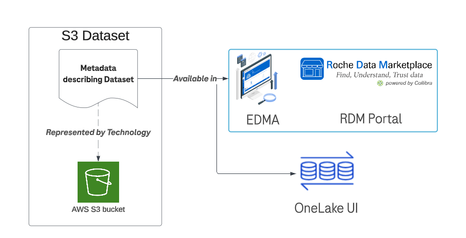

### Governed Object Storage/Governed Data Lake

Whether you are looking to store analytical data, apply FAIR principles, need a staging area before transitioning to Snowflake, or more, One Lake is preconfigured to meet your needs. 

You can work with OneLake for AWS S3 as one of two (or both) personas:

-  ***Data Producer*** - who register, access and manages Datasets with S3 buckets being located on OneLake AWS Accounts and available in RDM tool stack including EDMA for assembly into Datasets and Data Products (see [RDM nomenclature](https://rochewiki.roche.com/confluence/display/dataone/OneLake+for+AWS+Glue+Catalog#OneLakeforAWSGlueCatalog-RDMnomenclature) to familiarise with a difference between Data Asset, Dataset and Data Product)
-   ***Data Consumer**- who searches Data Product at RDM Portal, requests an access for it, and finally uses shared data in their AWS Account

