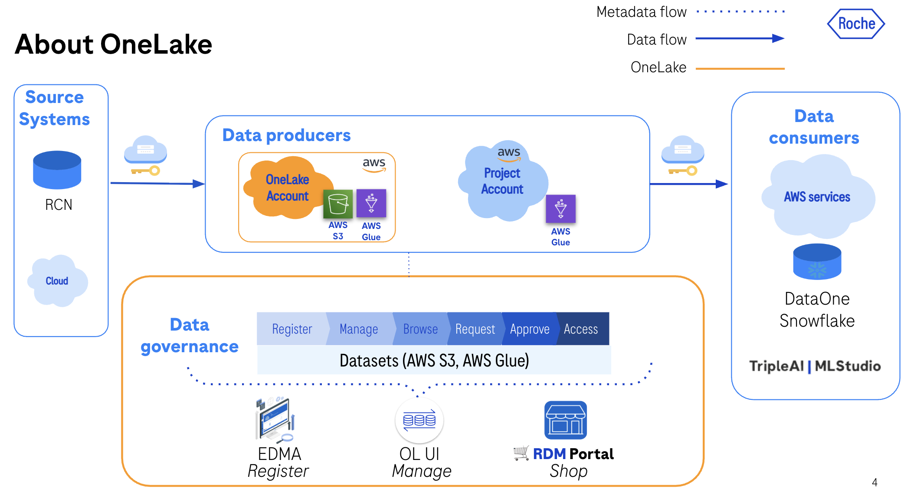

 🌊 OneLake Product

Your data management hub in the Roche ecosystem

Diagram provides a high-level map of how **OneLake** works as a central hub for DataOne at Roche. It shows the flow of data and how different teams interact with the platform.

- **Data Producers** (teams putting data in) first **Register** their datasets to make them discoverable. They also **Manage** the data to ensure it's up-to-date and accurate.
- **Data Consumers** (teams who need to use the data) can **Browse** the datasets in the **Roche Data Marketplace** (RDM Portal) and **Shop** for-or **Request**-access to the data they need.
- The entire process is governed by **Data Governance** rules, ensuring that data is accessed securely and correctly.
- The diagram illustrates that OneLake connects the original data sources with the systems used for advanced analysis, such as DataOne Snowflake, acting as the key link between those who provide the data and those who use it for projects.

More about key roles:

- **_Data Producer_** - who register, access and manages Datasets with S3 buckets being located on OneLake AWS Accounts and available in RDM tool stack including EDMA for assembly into Datasets and Data Products (see [RDM nomenclature](https://rochewiki.roche.com/confluence/display/dataone/OneLake+for+AWS+Glue+Catalog#OneLakeforAWSGlueCatalog-RDMnomenclature) to familiarise with a difference between Data Asset, Dataset and Data Product).
- **_Data Consumer_** \- who searches Data Product at RDM Portal, requests an access for it, and finally uses shared data in their AWS Account.